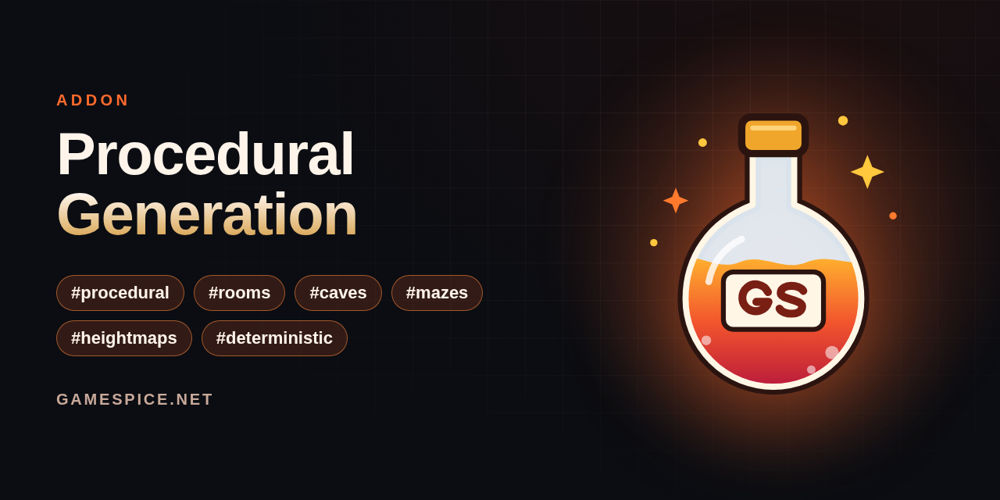

[](https://moddingcommunity.com/a/44-gs-procedural-generation)

Generated levels as an ordered pipeline of deterministic steps, with a validator that rejects maps nobody could finish.

The pipeline produces a document (`GSProcGenDoc`: a grid, rooms, links and markers), not nodes. Your game turns the document into a world. This means:

- Two machines can agree on a map by comparing a seed and `fingerprint()`.
- "Is it finishable?" is a flood fill you can ask.
- One generator serves 2D (tiles) and 3D (extruded).
- Generation can be spread over several frames.

## Install

1. Copy `addons/gs_procedural_generation/` and [GameSpice Core](https://github.com/gamespice-platform/core)'s `addons/gs_core/` into your project.
2. Enable it in *Project > Project Settings > Plugins*.

Only GameSpice Core is required.

## Use

```gdscript
var p := GSProcGenPipeline.new()
p.width = 64
p.height = 64
p.add(rooms).add(corridors).add(spawns).add(validate)
p.seed_source = rng                       # optional; takes the session's seed

var res := p.generate(seed)
if res.ok:
    build(res.value as GSProcGenDoc)
```

To spread the work over frames (on the main thread, so it works in web exports without threads):

```gdscript
runner.pipeline = p
runner.finished.connect(_build)
runner.begin(seed)
```

Sliced and blocking runs give exactly the same map.

## Steps

| Step | Purpose |
| --- | --- |
| `GSProcGenRooms` | Places rooms. |
| `GSProcGenCave` | Cellular-automata caves. |
| `GSProcGenConnect` | Joins rooms with a minimum spanning tree, then adds `extra_loops` more corridors so the level has loops. |
| `GSProcGenMarkers` | Places spawns, objectives and other markers. |
| `GSProcGenValidate` | Refuses unplayable maps. |

## The validator

Caves can seal off pockets, and a scattered objective can land in a room with no door. The validator catches this.

```gdscript
var check := GSProcGenValidate.new()
check.from_kind = &"spawn"
check.min_connected_fraction = 0.6
check.fill_unreachable = true          # usually better than failing
```

A failure is not a crash: the pipeline retries with another seed, up to `max_attempts` (default 10). The attempt number is mixed into the seed, so seed 41 never silently produces the map of seed 42.

## Random streams

Each step draws from its own named stream (`GSProcGenRandom` hashes the name). Adding a step does not change the output of steps before it, so shared seeds keep producing the same map. A game's own randomness addon supplies only the seed, through `seed_source`.

## Debugging

`to_ascii()` prints the map as text. Print it when a check fails.

See [docs/design.md](docs/design.md) and [docs/history.md](docs/history.md). The self-test is `examples/procgen_selftest.tscn`.

## Used by

One game vendors it, for a generated sandbox map:

- [Playlot](https://zeesgames.com/playlot) - builds its generated sandbox level from a pipeline document

The whole collection is at [zeesgames.com](https://zeesgames.com).

## Status and licence

Part of the [**GameSpice**](https://gamespice.net) platform: a family of Godot addons, MIT licensed and built with Claude Code. `res://examples/procgen_selftest.tscn` is the headless suite. The games in [Zee's Games](https://zeesgames.com) are built on GameSpice addons and run on live servers; this addon has one user among them. Please [open an issue](https://github.com/gamespice-platform/procedural-generation/issues) if you find a bug.

MIT licence, see [LICENSE](LICENSE). The only closed part of the [**GameSpice**](https://gamespice.net) platform is the web back end; you can use your own instead of GameSpice's.
